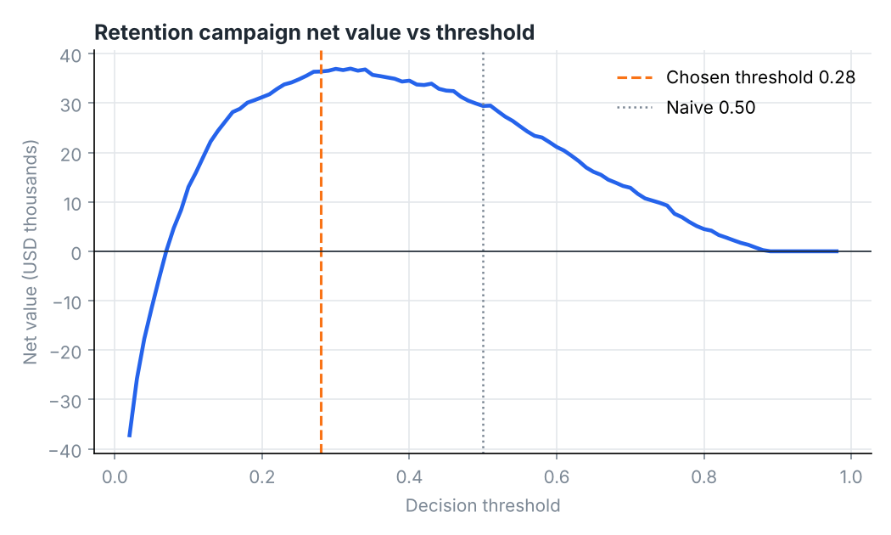
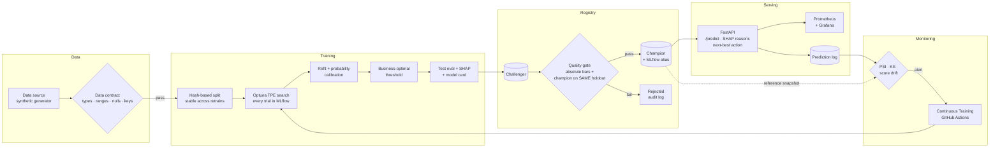
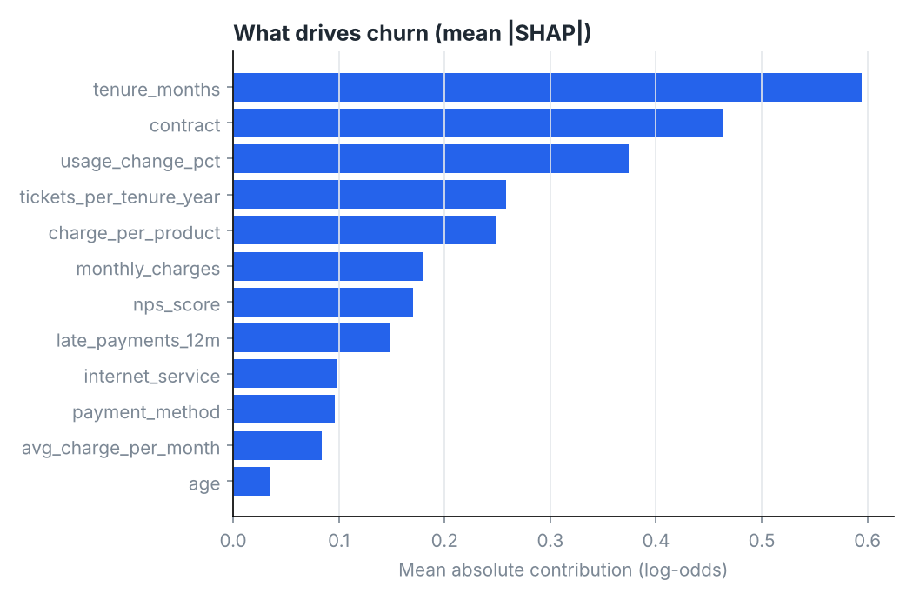
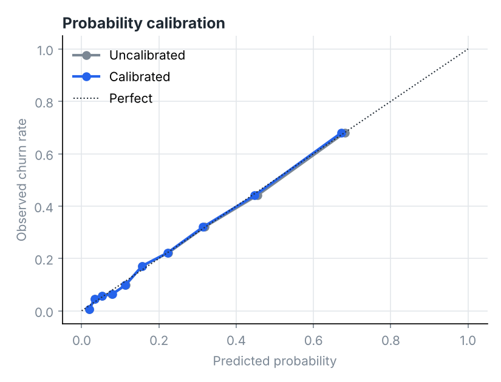

# ChurnGuard — Production MLOps for Customer Churn

[](https://github.com/johnbyronA/churnguard-mlops/actions/workflows/ci.yml)
[](https://github.com/johnbyronA/churnguard-mlops/actions/workflows/continuous-training.yml)


> **English** · [Español](#-español)

Most churn projects stop at a notebook with an AUC. **ChurnGuard is the whole lifecycle**: data contracts,
tracked hyperparameter search, calibrated probabilities, a decision threshold chosen by **money, not by 0.5**,
a quality-gated model registry, an explainable real-time API, drift monitoring and **automated retraining**
in CI — all reproducible with one command.

---

## The result in one picture

| | Net value of a retention campaign on 3,971 unseen customers |
|---|---:|
| Contact every customer | **−$45,759** |
| Model with the default 0.50 threshold | $29,415 |
| **Model with the business-optimal threshold (0.28)** | **$36,384 (+24%)** |
| Perfect foresight (upper bound) | $79,681 |

The model captures **46% of the theoretical maximum value** while contacting only 28% of customers.
Top-decile lift is **3.2×**: the 10% of customers it ranks riskiest churn at over three times the base rate.

<p align="center"></p>

| Metric (held-out test) | Value |
|---|---:|
| ROC-AUC | 0.826 |
| PR-AUC | 0.582 (base rate 0.21) |
| Brier score | 0.124 |
| Precision / Recall @ 0.28 | 0.49 / 0.66 |

---

## Architecture



## What makes it production-grade

| Concern | How ChurnGuard handles it |
|---|---|
| **Bad data** | Explicit data contract (`data/validate.py`): schema, dtypes, ranges, allowed categories, null budgets, duplicate keys and target sanity. Training *and* drift checks refuse broken data. |
| **Training/serving skew** | Feature engineering lives inside the scikit-learn `Pipeline`, so training, batch scoring and the API execute identical code. |
| **Reproducibility** | One `params.yaml`, pinned dependencies, seeded Optuna, data hash + git SHA stored with every model. |
| **Experiment tracking** | Every Optuna trial is a nested MLflow run; the final model is logged with signature and input example and registered with a `champion` alias. |
| **Trustworthy probabilities** | Platt calibration on a separate validation split (see calibration plot). Required, because the threshold is optimised on probabilities × money. |
| **A decision, not a score** | The threshold maximises expected campaign value: `P(retained) × 6 months of revenue − offer cost`. |
| **Safe promotion** | Champion/challenger registry. A challenger must clear absolute bars (AUC, PR-AUC, Brier) **and** match the champion re-scored on the *same* holdout, on both AUC and dollars. |
| **Leak-free retraining** | Customers are assigned to train/valid/test by a hash of their ID, so appending new data never moves a past test customer into training. |
| **Explainability** | Exact per-prediction TreeSHAP from LightGBM (`pred_contrib`), with one-hot columns folded back into business features. |
| **Drift** | PSI for every feature, KS tests for numerics and PSI on the score distribution. The baseline snapshot is versioned *inside* the model artifact. |
| **Continuous training** | Weekly GitHub Action: monitor → retrain only if drift alerts → quality gate → pull request with the new champion (a human still merges). |
| **Observability** | Prometheus metrics (volume, latency, risk mix, score histogram) and a provisioned Grafana dashboard. Every prediction is logged for monitoring. |
| **Ops hygiene** | Multi-stage non-root Docker image with healthcheck, hot model reload without downtime, CI smoke-tests the container. 35 tests, 94% coverage. |

## Explainability and drift

<p align="center">


</p>

When a simulated price increase and service incident hit production, monitoring flags it:
`support_tickets_90d` (PSI 0.35) and `monthly_charges` (PSI 0.26) cross the alert line, the mean churn score jumps
from 0.21 to 0.35, and the share of customers flagged rises from 28% to 53%. The continuous-training workflow
then retrains on the newly labelled data and only promotes the result if it beats the champion on the same holdout.

Open [`reports/model_card.html`](reports/model_card.html) and [`reports/drift_report.html`](reports/drift_report.html)
for the full reports (download and open in a browser).

## Quickstart

```bash
git clone https://github.com/johnbyronA/churnguard-mlops.git && cd churnguard-mlops
python -m venv .venv && source .venv/bin/activate
make install

make pipeline      # generate → validate → train (Optuna+MLflow) → gate → simulate drift → monitor
make retrain       # one continuous-training cycle on a drifted, labelled batch
make test          # 35 tests
make mlflow        # experiment UI at http://localhost:5000
make serve         # API at http://localhost:8000/docs
make up            # Docker: API + Prometheus (:9090) + Grafana (:3000)
```

The repository ships with a trained champion, so `make up` serves predictions right after cloning.

### Score a customer

```bash
curl -X POST localhost:8000/predict -H 'content-type: application/json' -d '{
  "customer_id": "CUST-000123", "age": 34, "city": "Medellin", "tenure_months": 4,
  "contract": "month-to-month", "internet_service": "fiber", "num_products": 1,
  "monthly_charges": 112.5, "total_charges": 450.0, "payment_method": "electronic_check",
  "paperless_billing": 1, "support_tickets_90d": 4, "late_payments_12m": 2,
  "usage_change_pct": -28.0, "nps_score": 3 }'
```

```json
{
  "customer_id": "CUST-000123",
  "churn_probability": 0.9489,
  "will_churn": true,
  "risk_band": "critical",
  "recommended_action": "Priority retention call within 24h + loyalty discount",
  "expected_value_of_action": 152.14,
  "top_reasons": [
    {"feature": "tenure_months", "value": 4, "impact": 0.8017},
    {"feature": "usage_change_pct", "value": -28.0, "impact": 0.7945},
    {"feature": "tickets_per_tenure_year", "value": 3.0, "impact": 0.5122}
  ],
  "model_version": "v20261028-193559"
}
```

| Endpoint | Purpose |
|---|---|
| `GET /health` | Liveness + loaded model version |
| `GET /model` | Model card: metrics, threshold, hyperparameters, feature importance |
| `POST /predict` | One customer, with SHAP reasons and next-best action |
| `POST /predict/batch` | Up to 1,000 customers |
| `POST /admin/reload` | Hot-swap the champion after a promotion (token-protected) |
| `GET /metrics` | Prometheus metrics |

## CI/CD

| Workflow | Trigger | What it does |
|---|---|---|
| `ci.yml` | push / PR | Ruff lint → pytest with coverage → full training run + quality gate + drift check (metrics posted to the job summary) → Docker build + container smoke test → push to GHCR on `main` |
| `continuous-training.yml` | weekly / manual | New production batch → drift check → retrain only when drift alerts → quality gate → PR with the new champion |

## Project structure

```
src/churnguard/
├── data/generate.py      synthetic subscription data (+ drift simulation)
├── data/validate.py      data contract
├── features.py           feature engineering + model pipeline
├── train.py              Optuna + MLflow + calibration + threshold + model card
├── business.py           campaign economics, risk bands, next-best action
├── registry.py           champion/challenger + quality gate + audit log
├── explain.py            TreeSHAP attributions
├── monitoring.py         PSI / KS / score drift + HTML report
├── reporting.py          figures + model card
├── serving/              FastAPI app + pydantic schemas
└── pipeline.py           `churnguard` CLI
tests/                    35 unit + integration tests
ops/                      Prometheus + Grafana provisioning
.github/workflows/        CI and continuous training
```

## A note on the data

The data is synthetic: a generator encodes realistic churn drivers (contract type, tenure, price sensitivity,
support friction, payment behaviour, usage trend, NPS) with interactions, noise and realistic missing values.
This keeps the project fully reproducible and free of personal data, while still giving the model real signal
and making drift scenarios controllable. Swapping in a real source only requires matching the data contract.

---

## 🇨🇴 Español

La mayoría de proyectos de churn terminan en un notebook con un AUC. **ChurnGuard cubre el ciclo de vida completo**:
contratos de datos, búsqueda de hiperparámetros con trazabilidad, probabilidades calibradas, un umbral de decisión
elegido **por dinero y no por 0.5**, un registro de modelos con compuerta de calidad, una API explicable en tiempo
real, monitoreo de drift y **reentrenamiento automático** en CI. Todo es reproducible con un solo comando.

### Resultado

Sobre 3.971 clientes que el modelo nunca vio, una campaña de retención:

- contactando a todos los clientes **pierde $45.759**;
- con el umbral por defecto de 0.50 gana $29.415;
- **con el umbral óptimo para el negocio (0.28) gana $36.384, un 24% más**;
- y captura el **46% del valor máximo teórico** contactando solo al 28% de los clientes.

ROC-AUC de 0.826, PR-AUC de 0.582 (con tasa base de 0.21), Brier de 0.124 y lift de **3.2×** en el decil superior.

### Qué lo hace de nivel producción

- **Contrato de datos**: valida esquema, tipos, rangos, categorías, presupuesto de nulos, llaves duplicadas y el target. Ni el entrenamiento ni el monitoreo aceptan datos rotos.
- **Sin training/serving skew**: la ingeniería de variables vive dentro del `Pipeline`, así que entrenamiento, scoring por lotes y la API ejecutan exactamente el mismo código.
- **Trazabilidad**: cada trial de Optuna es un run anidado en MLflow; el modelo final queda registrado con firma y alias `champion`, junto con el hash de los datos y el SHA de git.
- **Probabilidades confiables**: calibración de Platt en una partición separada, necesaria porque el umbral se optimiza sobre probabilidad × dinero.
- **Una decisión, no un puntaje**: el umbral maximiza el valor esperado de la campaña: `P(retención) × 6 meses de ingreso − costo de la oferta`.
- **Promoción segura**: registro campeón/retador. El retador debe superar umbrales absolutos (AUC, PR-AUC, Brier) **e** igualar al campeón re-evaluado sobre el *mismo* holdout, en AUC y en dólares.
- **Reentrenamiento sin fugas**: los clientes se asignan a train/valid/test por un hash de su ID, así los datos nuevos nunca mueven un cliente de prueba al entrenamiento.
- **Explicabilidad**: TreeSHAP exacto por predicción, agrupado de vuelta a variables de negocio.
- **Drift**: PSI por variable, pruebas KS y PSI sobre la distribución de puntajes. La referencia viaja *dentro* del artefacto del modelo.
- **Entrenamiento continuo**: un GitHub Action semanal monitorea, reentrena solo si hay alerta de drift, aplica la compuerta y abre un pull request con el nuevo campeón para aprobación humana.
- **Observabilidad**: métricas de Prometheus y dashboard de Grafana aprovisionado; cada predicción se registra para el monitoreo.
- **Operación**: imagen Docker multi-etapa sin root con healthcheck, recarga del modelo en caliente sin caída, y prueba de humo del contenedor en CI. 35 pruebas, 94% de cobertura.

### Inicio rápido

```bash
git clone https://github.com/johnbyronA/churnguard-mlops.git && cd churnguard-mlops
python -m venv .venv && source .venv/bin/activate
make install
make pipeline   # pipeline completo
make retrain    # un ciclo de entrenamiento continuo con drift
make up         # API + Prometheus + Grafana en Docker
```

### Sobre los datos

Los datos son sintéticos: un generador modela causas reales de abandono (tipo de contrato, antigüedad, sensibilidad
al precio, fricción con soporte, comportamiento de pago, tendencia de uso, NPS) con interacciones, ruido y valores
faltantes realistas. El proyecto es totalmente reproducible y no usa datos personales. Conectar una fuente real solo
requiere cumplir el contrato de datos.

---

**Author / Autor:** John Byron Alzate Hernández · Medellín, Colombia · [GitHub](https://github.com/johnbyronA)
